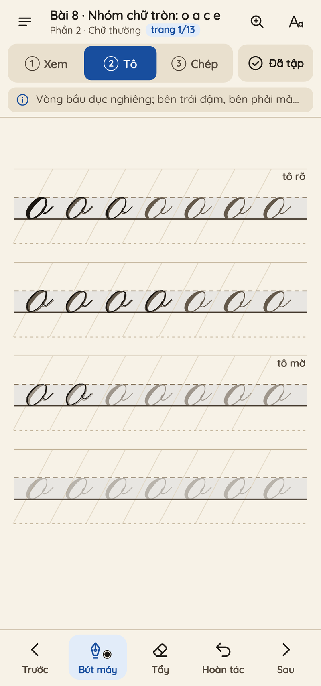
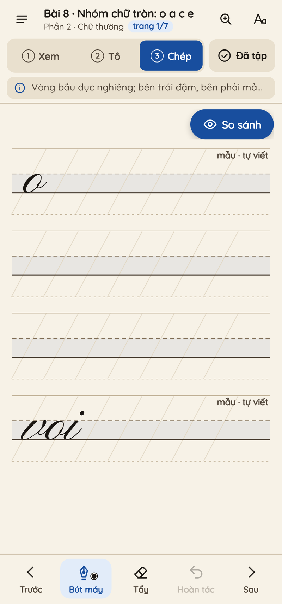
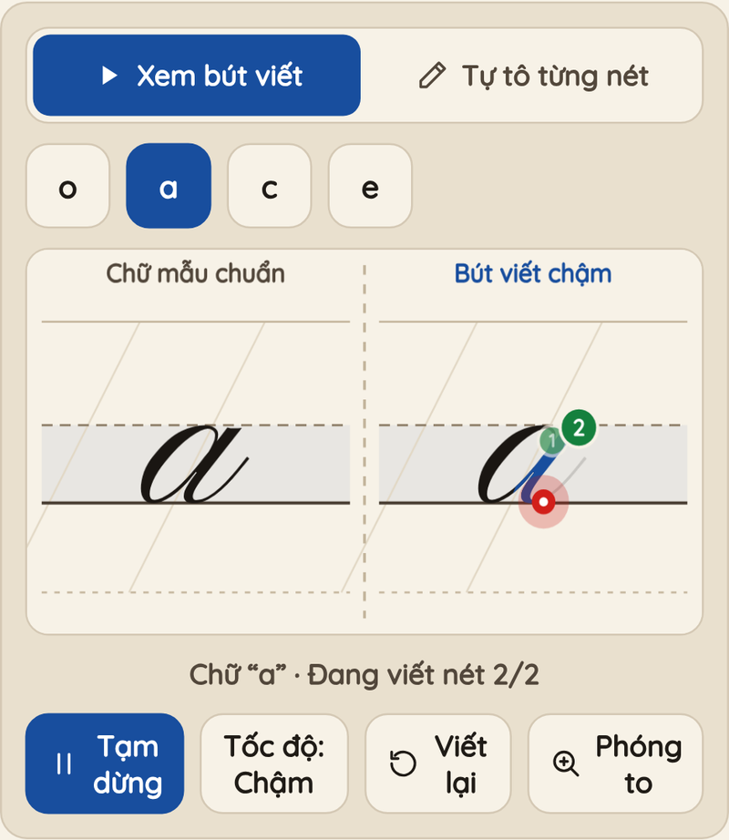
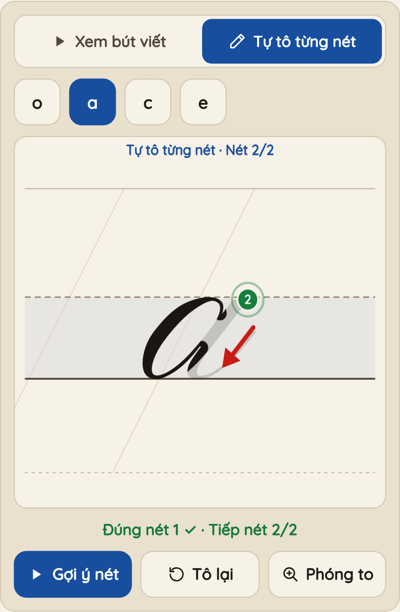

# ✍️ Tập viết S Pen

Luyện chữ đẹp tiếng Việt, kiểu thanh đậm và kiểu nét đều, ngay trên điện thoại hay máy tính bảng.

Bạn viết bằng S Pen hoặc bút cảm ứng lên màn hình. Ứng dụng chỉ cho bạn từng nét: đặt bút ở đâu, kéo theo hướng nào, nét nào viết trước, nét nào viết sau. Muốn tập trên giấy thì in vở ra khổ A4, A5, hoặc chép vào máy reMarkable.

Ứng dụng miễn phí, không quảng cáo, không cần tạo tài khoản. Toàn bộ chỉ gói trong một tệp HTML, không có mạng vẫn mở được, và không gửi bất cứ thứ gì của bạn ra ngoài.

👉 **[Mở ứng dụng để tập](https://luyenchudep.github.io/)**

Địa chỉ cũ luyenchudep.github.io/tap-viet-spen vẫn tự chuyển sang địa chỉ mới, bài viết đã lưu trên máy không bị mất.

Nên mở bằng Chrome hoặc Samsung Internet, rồi chọn **Thêm vào màn hình chính** để lần sau mở như một ứng dụng bình thường.

  
  &nbsp;
  

  
  &nbsp;
  

Tô theo mẫu · Chép lại · Xem bút viết chậm · Tự tô từng nét

> **Bản 0.10.3, đang thử nghiệm.** Ứng dụng đã chạy qua các bài kiểm tra tự động trên Chrome nhưng chưa được nhiều người dùng thử trên máy thật. Cách chấm điểm và độ nhạy khi tự tô từng nét có thể còn phải chỉnh. Bạn dùng thấy chỗ nào chưa ổn, rất mong bạn góp ý.

---

## Ứng dụng có gì

### Hai bộ bài tập, tổng cộng 82 bài

- **Chữ thanh đậm**, nghiêng 28 độ: 45 bài, chia làm 10 phần. Bắt đầu từ các nét cơ bản, rồi tới chữ thường, cách nối chữ, chữ hoa và chữ có dấu, kể cả những chữ mang hai dấu chồng lên nhau như ẫ, Ở, Ữ. Tiếp đó là viết từ, viết câu, chép Truyện Kiều, và cuối cùng là viết nhanh, ghi chép trên trang chia ba ô.
- **Chữ nét đều**, nghiêng 10 độ: 37 bài, chia làm 10 phần. Gồm chữ in dễ đọc, chữ số, ký hiệu, câu Việt – Anh và ghi chép hằng ngày.

Chữ cái nào, nét nào cũng có hướng dẫn thứ tự nét, tổng cộng 404 chữ và nét.

### Tập từ dễ đến khó

Mỗi bài đi qua từng bước: xem mẫu, tự tô từng nét, tô theo chữ mờ dần, chép lại, rồi ôn lại khi không còn nhìn mẫu.

- **① Xem**
  - *Bút viết chậm:* bút chạy đúng thứ tự nét với tốc độ đều, phía sau có bóng chữ mờ để bạn thấy tỉ lệ.
  - *Tự tô từng nét:* bạn tô bằng S Pen lên một ô chữ lớn. Ứng dụng xem bạn đặt bút có đúng chỗ không, báo ngay khi bạn kéo ngược chiều (hay gặp ở o, a, c, d, g), và vẽ lại nét mẫu khi bạn tô sai.
  - Đang ở trang tập mà quên cách viết, chỉ cần chạm ngón tay vào chữ mẫu đầu dòng là xem lại được ngay.
- **② Tô:** lúc đầu tô lên chữ rõ, sau đó chữ mờ dần, cuối cùng chỉ còn chấm xanh đánh dấu chỗ đặt bút. Tay quen dần, không cần dựa vào mẫu nữa.
- **③ Chép:** nhìn chữ mẫu đầu dòng rồi viết tiếp cả dòng. Chạm **So sánh** để đặt chữ mẫu màu đỏ đè lên chữ bạn viết, rồi tự chấm **Đạt** hay **Luyện thêm**.
- **Bài ôn:** chữ mẫu được giấu đi, bạn viết theo trí nhớ. Chữ nào đã đạt sẽ được nhắc ôn lại sau 1, 3, 7, 14 và 30 ngày.

### Viết bằng S Pen như viết trên giấy

- Có 6 loại bút: bút máy (nét to nhỏ theo lực tay, có sẵn ngòi lá tre), ngòi vát, bút bi nước, bút lông, bút chì và bút dạ quang.
- Có 12 màu mực, muốn thì tự pha thêm. Lưu được 4 cây bút hay dùng, giữ lâu nút Bút để đổi cho nhanh. Nét được làm mượt khi tay hơi run.
- Bật **Chỉ nhận S Pen** thì tì cả bàn tay lên màn hình cũng không vẽ bậy. Nút trên thân bút đặt được làm tẩy, hoàn tác hoặc đổi bút.
- **Hộp viết phóng to:** viết chữ to ở nửa dưới màn hình cho dễ. Viết tới mép thì hộp tự dịch sang phải, và chờ đủ lâu để bạn quay lại bỏ dấu.
- Chia đôi màn hình trên máy tính bảng. Có chế độ dành cho người thuận tay trái.
- Chọn lưới kẻ xiên kiểu Pháp hoặc vở 4 ô ly như ở trường.
- Có 4 màu giấy: Ấm, Sáng, Tối và Đen trắng (hợp với máy đọc sách).
- Ứng dụng đo được chữ bạn nghiêng bao nhiêu độ, nghiêng có đều không, nét có trơn tay không và giống chữ mẫu đến đâu. Mọi phép đo đều làm ngay trên máy.

### In vở và theo dõi việc tập

- Xuất vở PDF mà không cần mạng, đúng khổ giấy A4, sổ A5, máy reMarkable 2 và reMarkable Paper Pro. Trang đầu là mục lục, chạm vào tên bài là tới trang đó.
- Vở xuất ra là PDF dạng vectơ, có nhúng phông chữ. In ra hay phóng to cỡ nào nét cũng sắc, tệp lại nhẹ, và tìm được chữ trong vở.
- Ngoài ra còn có buổi tập 15 phút mỗi ngày, luyện viết tên và chữ ký, bài tự soạn, nhật ký luyện chữ, và lời nhắc tự kiểm tra chữ viết trên giấy hai tuần một lần.

---

## Dùng được trên máy nào

| Máy | Dùng thế nào |
|---|---|
| Điện thoại, máy tính bảng Samsung Galaxy có S Pen (mở bằng Chrome hoặc Samsung Internet) | Máy chính, dùng được mọi tính năng |
| Máy tính bảng Android khác, máy tính dùng chuột hoặc bút | Dùng được. Nếu bút không viết được, hãy tắt **Chỉ nhận S Pen** |
| Máy đọc sách Boox | Dùng được, nhưng nét hiện ra hơi chậm |
| reMarkable, Kindle Scribe | Dùng vở PDF xuất từ ứng dụng |

---

## Bắt đầu

1. **Mở trên web (nên chọn cách này):** vào [luyenchudep.github.io](https://luyenchudep.github.io/) trên điện thoại, máy tính bảng hay máy tính, rồi chọn **Thêm vào màn hình chính**.
2. **Mở tệp trên máy:** tải tệp `index.html` về rồi mở bằng trình duyệt. Có trình duyệt trên điện thoại không cho lưu bài khi mở tệp theo cách này, nên cách 1 chắc ăn hơn.

## Bài viết của bạn được lưu ở đâu

- Bài viết, tiến độ và cài đặt chỉ nằm trong trình duyệt trên máy bạn, không gửi đi đâu cả.
- Vì thế, nếu xóa dữ liệu trình duyệt hoặc đổi sang máy khác, bài viết sẽ mất.
- Thỉnh thoảng bạn nên sao lưu: vào **☰ Danh mục → Cài đặt → Dữ liệu → Sao lưu bài viết ra tệp**. Khi cần lấy lại, chọn **Khôi phục từ tệp sao lưu**.

---

## Giấy phép

- **Mã nguồn** theo giấy phép MIT: bạn được tự do dùng, chia sẻ và sửa. Xem tệp [`LICENSE`](LICENSE).
- **Phông chữ:** ứng dụng nhúng ba phông chữ mở, cùng theo giấy phép SIL Open Font License 1.1:
  - Pinyon Script cho chữ thanh đậm.
  - Allura cho chữ viết nhanh.
  - Quicksand cho chữ nét đều và giao diện. Vì đã được cắt bớt nên phông này phải đổi tên thành TV Sans, theo đúng quy định của giấy phép.

  Xem thêm ở tệp [`LICENSE-FONTS.md`](LICENSE-FONTS.md) và thư mục [`licenses/`](licenses/).

## Góp ý

Bạn gặp lỗi hiển thị, thấy chữ nào sai thứ tự nét, hay muốn có thêm bài tập nào, cứ mở một mục mới ở thẻ [Issues](https://github.com/luyenchudep/luyenchudep.github.io/issues). Góp ý của người dùng S Pen hay của người đang tự luyện chữ đều rất quý.

Những thay đổi qua từng bản: xem tệp [`CHANGELOG.md`](CHANGELOG.md).

Kiến trúc ứng dụng và kế hoạch cho các bản sắp tới: xem tệp [`docs/KIEN_TRUC.md`](docs/KIEN_TRUC.md).
